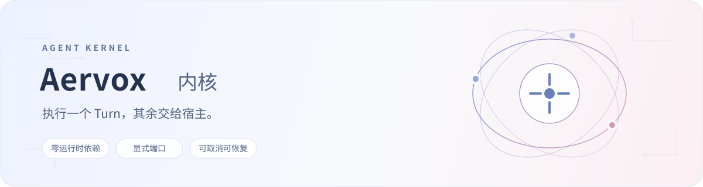
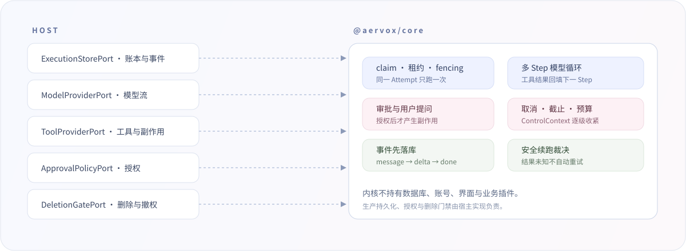
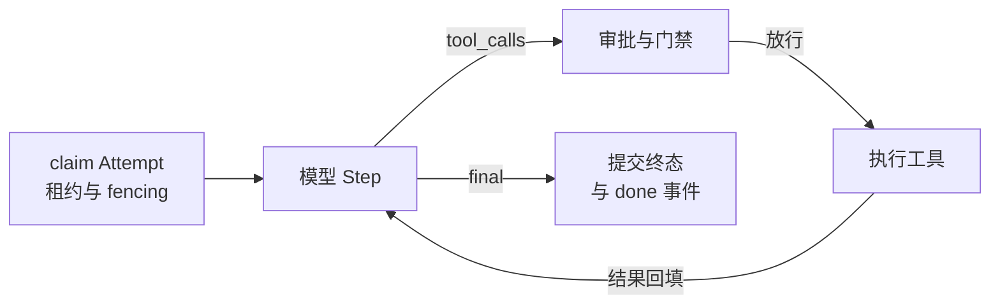

<h1 align="center"><br>Aervox｜思隅内核</h1>

<div align="center">

**把一个 Turn 跑完，其余交给宿主。**

Aervox 的独立 Agent 执行内核：模型与工具循环、审批、取消、事件账本与安全续跑裁决。



[](https://github.com/3yearsZhuang/Aervox-harness/blob/main/docs/reference/adr/ADR-021-aervox-core-standalone-package.md)

[主仓 Aervox-harness](https://github.com/3yearsZhuang/Aervox-harness) · [架构说明](https://github.com/3yearsZhuang/Aervox-harness/blob/main/docs/reference/ARCHITECTURE.md) · [执行与恢复契约](https://github.com/3yearsZhuang/Aervox-harness/blob/main/docs/reference/agent-harness-loop.md#execution-contract) · [参与贡献](https://github.com/3yearsZhuang/Aervox-harness/blob/main/CONTRIBUTING.md)

</div>

内核是库，不是产品。它不持有应用数据库、账号、界面或业务插件；持久化、副作用授权与删除门禁都由宿主实现。**运行时依赖为零**，只依赖宿主注入的端口。当前为 workspace 包，尚未发布到 npm。

## 看看内核怎么分工



图中五个方向都由宿主实现，内核只决定「按什么顺序、以什么条件」调用它们：领取执行权之后跑模型与工具循环，每个 Step 先写事件再向下推进，遇到需要授权的工具先问审批，任何时刻都可以取消，结束时提交单一终态。

## 一次 Turn 在内核里发生什么



模型请求工具时先过审批与门禁：放行则执行并把结果回填下一 Step，拒绝或需要人工决定则回到循环继续判断，不会绕过授权直接产生副作用。

事件按序落库，客户端看到的流是账本的投影，而不是模型直连：

```text
message → delta* → tool_request → tool_result → delta* → done
```

| 内核负责 | 宿主负责 |
|---|---|
| 领取 Attempt，防重复执行的租约与 fencing | 账本、事件与工具结果的持久化 |
| 多 Step 模型—工具循环与步数/时长/预算边界 | 真实模型连接与协议转换 |
| 审批决策顺序、待决工具的重放与拒绝 | 向用户实际征询并返回决议 |
| 取消、截止、ControlContext 逐级收紧 | 进程生命周期、资源回收 |
| 记录工具副作用意图与权威结果 | 文件、网络、数据库等外部副作用的执行与授权边界 |
| 判断在什么前提下可以安全续跑 | 恢复的启动、隔离与降级开关 |

## 快速开始

先安装 [mise](https://mise.jdx.dev/getting-started.html)，在仓库根执行：

```sh
mise trust
mise install
mise exec -- pnpm install --frozen-lockfile
mise exec -- pnpm build
mise exec -- pnpm typecheck
mise exec -- pnpm test
```

工具版本由 [mise.toml](mise.toml) 与 `packageManager` 固定，依赖全部在根安装。`typescript`、`vitest`、`esbuild` 与 Node 类型只用于开发，不进入运行时依赖；构建产物在被忽略的 `dist/`。

若要单独验证平台中立边界：

```sh
mise exec -- pnpm test:browser
```

该用例把 `@aervox/core/browser` 打包为浏览器产物，在没有 `process`、`require` 与 `Buffer` 的上下文里跑完一个 Turn，并用关闭 ambient Node 类型的方式检查声明文件闭包。

## 使用

三个入口各有明确读者，包名保持 `@aervox/core`：

| 入口 | 用途 |
|---|---|
| `@aervox/core` | 完整内核，含 Node 终端审批策略 |
| `@aervox/core/core` | 轻量组合入口，只含纯内存、进程内执行管道 |
| `@aervox/core/browser` | 平台中立入口，不含终端审批与任何 Node 内置模块 |

作为 workspace 包接入并构建后：

```ts
import {
  defaultContextBuilder,
  executeTurn,
  InMemoryExecutionStore,
  type ModelProviderPort,
} from "@aervox/core/browser";

const execution = new InMemoryExecutionStore();
execution.seedAttempt({ id: "attempt-1", turnId: "turn-1" });

const provider: ModelProviderPort = {
  id: "example",
  async *stream() {
    yield { text: "你好", isFinal: false };
    yield { text: "", isFinal: true };
  },
};

const result = await executeTurn(
  { execution, provider, contextBuilder: defaultContextBuilder },
  { turnId: "turn-1", attemptId: "attempt-1", sessionId: "session-1", userMessage: "你好" },
);

console.log(result.status); // completed
```

示例使用内存账本与固定模型输出，只为展示端口接入。接入只读工具时，把 `tools` 与 `approvalPolicy` 一并注入；模型在首个 Step 请求工具，内核据审批策略放行并把结果回填下一 Step：

```ts
import {
  AutoApprovalPolicy,
  createMockToolProvider,
  defaultContextBuilder,
  executeTurn,
  InMemoryExecutionStore,
  type ModelProviderPort,
} from "@aervox/core/browser";

const execution = new InMemoryExecutionStore();
execution.seedAttempt({ id: "attempt-2", turnId: "turn-2" });

const provider: ModelProviderPort = {
  id: "example",
  async *stream(request) {
    if (request.step === 1) {
      yield { text: "我先查一下。", isFinal: false };
      yield {
        text: "",
        isFinal: true,
        toolCalls: [{ id: "call-1", name: "search_notes", arguments: { q: "复习" } }],
      };
      return;
    }
    yield { text: "查到一条笔记。", isFinal: true };
  },
};

const result = await executeTurn(
  {
    execution,
    provider,
    contextBuilder: defaultContextBuilder,
    tools: createMockToolProvider(),
    approvalPolicy: new AutoApprovalPolicy({ mode: "read_only" }),
  },
  { turnId: "turn-2", attemptId: "attempt-2", sessionId: "session-2", userMessage: "今天的复习计划？" },
);

console.log(result.status, result.stepsTaken); // completed 2
```

事件序列为 `message → delta → tool_request → tool_result → delta → done`，工具账本留下一条 `executed` 记录。未配置 `tools` 时工具请求按 fail-closed 拒绝，不会静默放行。

生产宿主需要自行提供持久存储、实际模型、工具权限、取消与删除控制。

## 端口与责任

完整签名以 [src/ports.ts](src/ports.ts)、[src/types.ts](src/types.ts) 与公开入口声明为准。

| 端口 / 控制契约 | 宿主责任 |
|---|---|
| `ExecutionStorePort` / `SessionLedgerPort` | 执行状态、租约与 fencing、幂等预留、事件与工具结果的原子持久化 |
| `ModelProviderPort` | 模型流、工具调用与模型终态的协议转换 |
| `ContextBuilderPort` / `ContextCompactionPort` | 输入上下文与受控压缩 |
| `ToolProviderPort` / `HostToolRegistryPort` | 工具白名单、声明、调用及资源边界 |
| `ApprovalPolicyPort` / `UserQuestionPort` | 人工审批与用户提问交互 |
| `InboxPort` / `SubagentPort` | 外部输入与有界子任务委托 |
| `DeletionGatePort` / `ControlContext` | 删除及撤权门禁、取消、截止时间与预算 |
| `TextEmbeddingPort` / `ToolValidatorPort` | 可选向量能力及宿主 Schema 方言校验 |

内核提供内存实现供测试与集成使用：`InMemoryExecutionStore`、`InMemoryInbox`、`HostToolRuntime`、`createFauxProvider`、`createReplayProvider`。它们让契约可被独立验证，但不构成操作系统隔离沙箱，也不替代宿主的持久化与授权。

## 设计约束

- **零运行时依赖。** `dependencies` 为空；不引入 SQLite、LibSQL、Drizzle 或其他持久层。
- **端口显式。** 内核只依赖 [src/ports.ts](src/ports.ts) 声明的契约，不导入主仓 Contracts、业务 Schema 或宿主实现。
- **事件先行。** 模型片段先持久化为事件再投影给客户端；副作用意图先于外部调用持久化。
- **失败收敛。** 未注册工具、缺失门控上下文、结果未知的副作用一律拒绝或中断，不自动重试。
- **恢复受限。** 只有账本完整、结果确定且审批已决的执行才可续跑；未知结果、待决审批、撤权、删除与损坏配对均拒绝。
- **内存实现不是沙箱。** 工具运行器的隔离、网络与文件边界由宿主承担。

## 与主仓的关系

[Aervox-harness](https://github.com/3yearsZhuang/Aervox-harness) 将本仓库作为 `packages/core` Git submodule 固定到确定提交，并按 `@aervox/core` workspace 包消费。内核变更在本仓库的 `feat/`、`fix/` 或 `docs/` 分支审查；主仓另用 PR 更新 gitlink，并验证锁文件与实际下游。

```sh
git submodule update --init packages/core
mise exec -- pnpm install --frozen-lockfile
```

本仓库保留独立 mise、包管理器、锁文件与 CI（构建、类型检查、浏览器边界测试）。主仓构建与测试由主仓工具链编排。与主仓业务 Schema 的类型兼容证明留在宿主测试中，本仓库独立通过不能替代主仓消费者验收，也不代表已完成宿主集成、生产部署或软件发布。

## 继续了解

| 想了解什么 | 从这里开始 |
|---|---|
| 为什么独立成包、边界与许可如何划分 | [ADR-021](https://github.com/3yearsZhuang/Aervox-harness/blob/main/docs/reference/adr/ADR-021-aervox-core-standalone-package.md) |
| 执行、取消、恢复与事件流的完整契约 | [Agent Harness Loop](https://github.com/3yearsZhuang/Aervox-harness/blob/main/docs/reference/agent-harness-loop.md) |
| 宿主、仓储、插件与内核的模块关系 | [架构说明](https://github.com/3yearsZhuang/Aervox-harness/blob/main/docs/reference/ARCHITECTURE.md) |
| 当前进展与剩余验收 | [需求追踪](https://github.com/3yearsZhuang/Aervox-harness/blob/main/docs/reference/REQUIREMENTS_TRACEABILITY.md) |
| 提交改动与运行检查 | [贡献指南](https://github.com/3yearsZhuang/Aervox-harness/blob/main/CONTRIBUTING.md) |

## 来源与许可

源码来自 Aervox-harness 的 `packages/core`。迁移保留了该路径的过滤提交历史、原始提交者与版权；路径过滤后的提交哈希与原仓库不同，主仓原提交与架构记录仍可在 [Aervox-harness](https://github.com/3yearsZhuang/Aervox-harness) 查阅。

本仓库内核采用 **Apache-2.0**，完整许可证见 [LICENSE](LICENSE)，原许可与版权声明保留。Aervox-harness 主仓其余源码与文档的许可分别由主仓对应许可证定义，接入内核不改变这些文件的许可。
